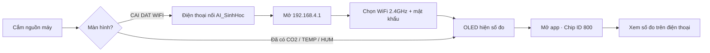

# Hướng dẫn kết nối WiFi & app

> Viết cho giáo viên / phụ huynh **không cần biết lập trình**.  
> Làm đúng từng bước. Nếu lệch bước, xem mục **Khi bị lỗi**.

---

## Trước khi bắt đầu — chuẩn bị gì?

| Thứ cần có | Ghi chú |
|------------|---------|
| Máy AI Sinh Học | Đã lắp sẵn dây |
| Cáp USB + ổ điện / sạc điện thoại | Cấp nguồn cho máy |
| Điện thoại (Android/iOS) | Có WiFi |
| WiFi nhà hoặc trường | Phải là **2.4GHz** (xem mục cuối) |
| Mật khẩu WiFi | Hỏi quản trị mạng trường nếu cần |
| App **AI Sinh Học** | Cài sẵn trên điện thoại |

---

## Phần A — Kết nối máy với WiFi nhà / trường

### Bước 1: Bật máy

1. Cắm cáp USB vào bo mạch ESP32.
2. Cắm đầu kia vào ổ sạc hoặc máy tính.
3. Nhìn **màn hình OLED** (màn hình nhỏ đen trắng).

Có 2 trường hợp:

| Màn hình hiện | Ý nghĩa | Làm gì tiếp |
|---------------|---------|-------------|
| Số **CO2 / TEMP / HUM** | Máy đã nhớ WiFi cũ và đang đo | Sang **Phần B** (mở app) |
| Chữ **CAI DAT WIFI** | Máy đang chờ bạn cho mật khẩu WiFi mới | Làm tiếp Bước 2 → 5 |

Màn hình khi cần cấu hình WiFi trông như thế này:

```
      CAI DAT WIFI
   ─────────────────
        Noi DT:
       AI_SinhHoc
       192.168.4.1
```

### Bước 2: Điện thoại nối WiFi của máy

1. Vào **Cài đặt → WiFi** trên điện thoại.
2. Tìm mạng tên đúng: **`AI_SinhHoc`**
3. Bấm nối. **Không có mật khẩu** — chọn nối / bỏ qua mật khẩu nếu điện thoại hỏi.
4. Giữ điện thoại **ở gần máy** (trong cùng phòng).

> Đừng nối WiFi nhà ở bước này. Lúc này điện thoại phải nối **`AI_SinhHoc`**.

### Bước 3: Mở trang cấu hình

1. Mở **trình duyệt** (Chrome, Safari…).
2. Gõ địa chỉ (không cần tìm Google):

```
http://192.168.4.1
```

3. Bấm Enter / Go.

Nếu trang không hiện:

- Kiểm tra điện thoại vẫn đang nối `AI_SinhHoc` (một số máy tự nhảy về WiFi nhà).
- Tắt **Dữ liệu di động (4G/5G)** tạm thời rồi thử lại.
- Gõ lại đúng: `192.168.4.1`

### Bước 4: Chọn WiFi nhà / trường

Trên trang web:

1. Bấm **Quet mang WiFi** (nếu danh sách trống).
2. Chạm vào tên WiFi nhà/trường trong danh sách  
   **hoặc** gõ tay tên WiFi vào ô “Ten WiFi”.
3. Gõ **mật khẩu WiFi** vào ô bên dưới.
4. Bấm **Ket noi**.
5. Chờ khoảng **15 giây**. **Đừng đổi WiFi điện thoại** trong lúc này.

### Bước 5: Biết đã thành công

| Dấu hiệu | Ý nghĩa |
|----------|---------|
| Trang báo **OK** | Thành công |
| Màn OLED **hết** chữ “CAI DAT WIFI”, hiện số CO₂ / nhiệt độ / độ ẩm | Thành công |
| Máy tự khởi động lại ngắn | Bình thường |

Xong Phần A → sang Phần B.

---

## Phần B — Mở app xem số đo

1. Điện thoại nối lại **WiFi nhà / trường** (có internet).
2. Mở app **AI Sinh Học**.
3. Nếu hỏi **Chip ID**, nhập: **`800`** (mặc định của bộ kit).
4. Đợi vài giây — app hiện nhiệt độ, độ ẩm, CO₂ giống màn hình máy.

```
  Máy đo ──WiFi──► Internet ──► App điện thoại
     │
     └── OLED cũng hiện số ngay trên máy
```

---

## Phần C — Đổi WiFi (mang máy sang phòng / nhà khác)

Không cần cắm máy tính, **không cần nạp lại code**.

1. Mang máy đến chỗ WiFi mới, cắm nguồn.
2. Nếu máy **không thấy** WiFi cũ → màn hình tự hiện **CAI DAT WIFI**.
3. Làm lại Phần A (Bước 2 → 5) với WiFi mới.

> Nếu WiFi cũ vẫn còn sóng (ví dụ vẫn ở gần) mà muốn đổi mạng: tạm **tắt WiFi cũ** hoặc mang máy ra xa, rồi bật nguồn lại.

---

## Khi bị lỗi — bảng tra nhanh

| Hiện tượng | Thử làm |
|------------|---------|
| Không thấy WiFi `AI_SinhHoc` | Cắm lại nguồn; đứng gần máy; tắt/bật WiFi điện thoại |
| Vào được `AI_SinhHoc` nhưng trang `192.168.4.1` trắng | Tắt 4G/5G; thử Chrome; gõ lại `http://192.168.4.1` |
| Báo sai mật khẩu / không phải 2.4GHz | Kiểm tra mật khẩu; chọn đúng WiFi **2.4GHz** (xem mục dưới) |
| OLED có số nhưng app không có số | Điện thoại phải có internet; Chip ID = `800`; đợi 10–20 giây |
| OLED đen hoàn toàn | Kiểm tra cáp nguồn; xem [03-so-do-mach.md](03-so-do-mach.md) |
| Số CO₂ nhảy chậm lúc mới bật | Cảm biến cần **1–3 phút** ổn định — bình thường |

---

## WiFi 2.4GHz là gì? (giải thích siêu ngắn)

WiFi nhà thường có **hai loại sóng**:

| Loại | Máy AI Sinh Học |
|------|-----------------|
| **2.4GHz** (tên thường có đuôi `2.4`, `2G`, hoặc không ghi gì) | **Dùng được** |
| **5GHz** (tên có `5G`, `5GHz`, `5`) | **Không dùng được** |

Nếu modem chỉ hiện một tên WiFi (gộp 2.4 + 5):

- Vào trang quản trị modem (hoặc hỏi IT trường) → tạm **tách** / bật riêng mạng 2.4GHz,  
  **hoặc** đứng gần modem và chọn đúng tên mạng 2.4 nếu có.

---

## Checklist giao máy cho học sinh / đồng nghiệp

In hoặc chụp checklist này dán túi kit:

- [ ] Cắm nguồn → OLED sáng
- [ ] Điện thoại nối `AI_SinhHoc`
- [ ] Mở `http://192.168.4.1`
- [ ] Chọn WiFi **2.4GHz** + mật khẩu đúng
- [ ] OLED hiện số đo (không còn “CAI DAT WIFI”)
- [ ] App Chip ID = `800`, thấy số giống OLED

---

## Sơ đồ tổng thể (dành cho giáo viên trình chiếu)


