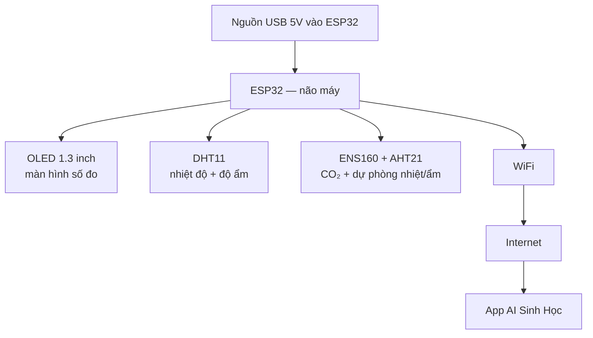
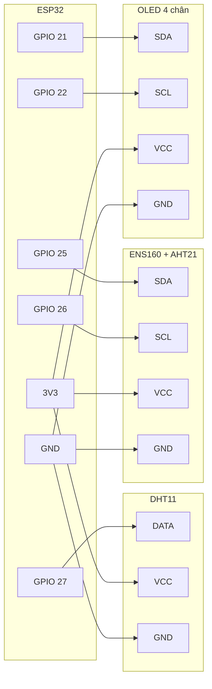
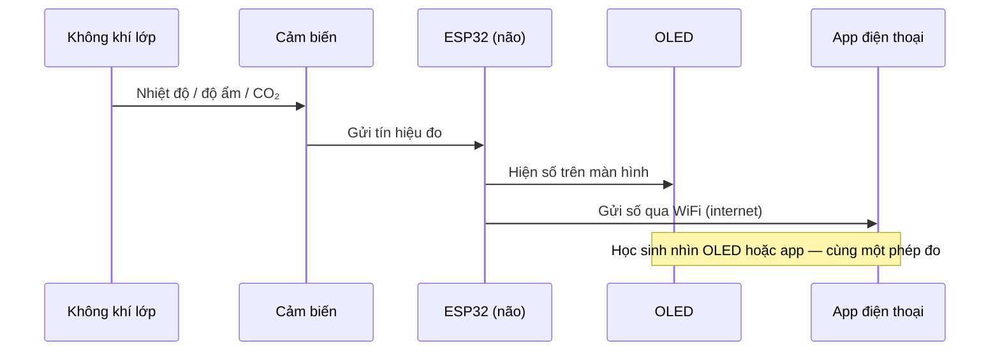

# Sơ đồ mạch & nối dây — AI Sinh Học

> Dùng để: kiểm tra dây, sửa lỗi “màn đen / không đo được”, hoặc dạy STEM.  
> Nguồn cảm biến & OLED: dùng **3.3V** (không cấp 5V nếu module ghi 3.3V).

---

## 1. Tổng quan hệ thống (nhìn một hình là hiểu)



**Ý nghĩa đơn giản:**

- ESP32 đọc 3 cảm biến / màn hình.
- Số đo hiện trên OLED ngay tại chỗ.
- Đồng thời gửi qua WiFi lên app điện thoại.

---

## 2. Sơ đồ khối chân (pin) — giáo viên trình chiếu



---

## 3. Bảng nối dây chi tiết (in ra dán cạnh kit)

### 3.1. Màn hình OLED (module 4 chân)

Thứ tự chân thường in trên PCB: **GND · VCC · SCL · SDA** (kiểm tra chữ in trên module của bạn).

| Chân OLED | Nối tới ESP32 | Ghi chú |
|-----------|---------------|---------|
| **GND** | **GND** | Đất chung |
| **VCC** | **3V3** | Không cấp 5V nếu module ghi 3.3V |
| **SCL** | **GPIO 22** | Đồng hồ I2C (bus màn hình) |
| **SDA** | **GPIO 21** | Dữ liệu I2C (bus màn hình) |

### 3.2. Module ENS160 + AHT21 (đo CO₂, có sẵn cảm biến nhiệt/ẩm dự phòng)

| Chân module | Nối tới ESP32 | Ghi chú |
|-------------|---------------|---------|
| **GND** | **GND** | Đất chung |
| **VCC** | **3V3** | |
| **SCL** | **GPIO 26** | I2C bus cảm biến (Wire1) |
| **SDA** | **GPIO 25** | I2C bus cảm biến (Wire1) |

> OLED và ENS160 dùng **hai bus I2C khác nhau** — **không** nối chung chân 21/22 với 25/26.

### 3.3. Cảm biến DHT11 (nhiệt độ · độ ẩm chính)

| Chân DHT11 | Nối tới ESP32 | Ghi chú |
|------------|---------------|---------|
| **GND** / `-` | **GND** | |
| **VCC** / `+` | **3V3** (hoặc 5V tùy module) | Xem chữ in trên module |
| **DATA** / `OUT` | **GPIO 27** | Dây tín hiệu |

*(Một số module DHT11 3 chân đã có trở kéo sẵn trên board.)*

---

## 4. Sơ đồ ASCII “nhìn như bàn lắp”

Dễ photocopy phát học sinh STEM:

```
                    ┌──────────────────────┐
                    │       ESP32          │
                    │                      │
   OLED SDA ───────►│ 21                   │
   OLED SCL ───────►│ 22                   │
   ENS  SDA ───────►│ 25                   │
   ENS  SCL ───────►│ 26                   │
   DHT  DATA ──────►│ 27                   │
   tất cả VCC ─────►│ 3V3                  │
   tất cả GND ─────►│ GND                  │
                    │              USB ────┼──► nguồn / máy tính
                    └──────────────────────┘

   ┌─────────┐   ┌──────────────┐   ┌─────────┐
   │  OLED   │   │ ENS160+AHT21 │   │  DHT11  │
   │ 1.3"    │   │   (CO₂…)     │   │ Temp/Hum│
   └─────────┘   └──────────────┘   └─────────┘
```

---

## 5. Sơ đồ nguyên lý đơn giản (cho bài giảng)



---

## 6. Quy tắc an toàn khi nối dây

1. **Rút nguồn USB** trước khi cắm/rút dây jumper.
2. **GND chung** cho mọi module với ESP32.
3. Ưu tiên **3V3** cho OLED / ENS160.
4. Không để hai dây tín hiệu chạm nhau (đặc biệt SDA/SCL).
5. Dây dài quá → tín hiệu I2C dễ lỗi; giữ dây ngắn gọn.
6. Không siết ốc / bẻ chân module mạnh.

---

## 7. Checklist khi máy lỗi phần cứng

| Hiện tượng | Kiểm tra theo thứ tự |
|------------|----------------------|
| OLED đen | USB có nguồn? VCC→3V3, GND→GND, SDA→21, SCL→22? |
| OLED sáng nhưng không có số / nhiễu | Đổi chỗ dây SDA/SCL (hay bị đảo); tiếp xúc hàn/jumper |
| Không có nhiệt/ẩm | DHT DATA → 27; thử lại sau 2 phút |
| Không có CO₂ (hiện `----`) | ENS VCC/GND; SDA→25, SCL→26; chờ 1–3 phút warm-up |
| OLED OK, app không số | Không phải lỗi dây — xem [01-huong-dan-ket-noi.md](01-huong-dan-ket-noi.md) (WiFi / Chip ID) |

---

## 8. Phiếu học sinh STEM (tô màu / nối dây trên giấy)

In hình dưới, yêu cầu học sinh **nối mũi tên** đúng chân:

```
OLED.SDA     (   )     ESP32 GPIO 21
OLED.SCL     (   )     ESP32 GPIO 22
ENS.SDA      (   )     ESP32 GPIO 25
ENS.SCL      (   )     ESP32 GPIO 26
DHT.DATA     (   )     ESP32 GPIO 27
Tất cả GND   (   )     ESP32 GND
OLED/ENS VCC (   )     ESP32 3V3
```

**Đáp án giáo viên:** nối thẳng theo từng dòng (SDA OLED↔21, SCL OLED↔22, …).

---

## 9. Tóm tắt 1 dòng cho giáo viên nhớ

> **OLED = 21/22 · ENS = 25/26 · DHT = 27 · nguồn 3V3/GND chung · WiFi 2.4GHz · Chip ID 800.**
